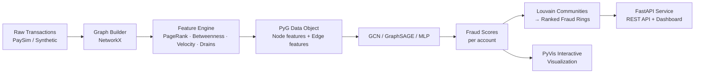

<p align="center">
  <h1>Graph-ML</h1>
  <strong>GNN Fraud Ring Detection on Transaction Networks</strong>
</p>

<p align="center">
  
  
  
  
  
</p>

---

## The Problem

Traditional tabular fraud detection treats each account in isolation. Real money laundering involves **fraud rings** — coordinated networks of mule accounts that move stolen funds through layered chains before cashing out. A single-account view misses the structural signal entirely.

## The Approach

**FraudGraph** models the entire transaction network as a graph (accounts = nodes, transactions = edges) and uses Graph Neural Networks to classify accounts as *fraud* or *legit* based on both their own behaviour **and** their neighbourhood's behaviour. Three models are compared:

| Model | PR-AUC | F1 | Precision | Recall | How it works |
|---|---|---|---|---|---|
| **GraphSAGE** ⭐ | **0.987** | **0.944** | 0.895 | **1.000** | Neighbourhood-aware aggregation (inductive) |
| GCN | 0.969 | 0.914 | 0.889 | 0.941 | Spectral graph convolution |
| MLP (no graph) | 0.963 | 0.909 | 0.938 | 0.882 | Same features, no structure — ablation |

> Both GNNs outperform the graph-blind MLP, and GraphSAGE achieves **perfect fraud recall** — catching every fraud account in the held-out test set.

Detected fraud rings are visualized interactively (see `reports/fraud_ring.html`).

## Architecture



## Quick Start

```bash
# 1. Install dependencies (CPU — no GPU required)
python -m venv .venv && source .venv/bin/activate  # or .venv\Scripts\activate on Windows
pip install -r requirements-dev.txt
pip install -e .

# 2. Generate synthetic data (or drop data/paysim.csv from Kaggle)
python scripts/generate_data.py

# 3. Train models and produce reports
python scripts/train.py

# 4. Detect fraud rings and render visualization
python scripts/detect_rings.py
python scripts/make_viz.py

# 5. Launch the API
uvicorn fraudgraph.api.main:app --reload
# → http://localhost:8000         (dashboard)
# → http://localhost:8000/docs    (Swagger API)
# → http://localhost:8000/viz    (interactive ring graph)
```

### Using real PaySim data

Download `paysim.csv` from [Kaggle](https://www.kaggle.com/ealgaba/payim-synthetic-fraud-detection) and place it in `data/paysim.csv`:

```bash
python scripts/train.py --data paysim
python scripts/detect_rings.py --data paysim
python scripts/make_viz.py --data paysim
```

## Project Structure

```
Graph-ML/
├── src/fraudgraph/
│   ├── config.py                # Seeds, paths, hyperparameters
│   ├── data/
│   │   ├── synthetic.py         # PaySim-style generator w/ injected fraud rings
│   │   ├── paysim_loader.py     # Real PaySim CSV loader
│   │   ├── graph_builder.py     # Accounts → PyG Data with bidirectional edges
│   │   └── dataset.py           # Unified data access
│   ├── features/
│   │   └── graph_features.py    # 14 features: degree, PageRank, betweenness, velocity…
│   ├── models/
│   │   ├── gcn.py               # Graph Convolutional Network
│   │   ├── graphsage.py         # GraphSAGE (inductive, mean aggregation)
│   │   └── mlp.py               # Ablation baseline (no graph structure)
│   ├── train/
│   │   ├── trainer.py           # Weighted BCE, early stopping on PR-AUC
│   │   └── metrics.py           # P/R/F1/PR-AUC/ROC-AUC/confusion matrix
│   ├── rings/
│   │   └── detector.py         # Louvain → fraud-density ranked rings
│   ├── viz/
│   │   ├── pyvis_graph.py       # Interactive HTML network graph
│   │   └── figures.py          # PR curves, confusion matrices
│   └── api/
│       ├── main.py              # FastAPI: /score, /rings, /viz, /metrics
│       └── static/dashboard.html
├── scripts/
│   ├── generate_data.py
│   ├── train.py
│   ├── detect_rings.py
│   └── make_viz.py
├── tests/                       # 16 tests — graph, features, models, rings
├── reports/                     # metrics.json, rings.json, fraud_ring.html, figures/
├── Dockerfile
└── docker-compose.yml
```

## API Endpoints

| Endpoint | Method | Description |
|---|---|---|
| `/health` | GET | Liveness check, returns best model name |
| `/` | GET | Interactive dashboard |
| `/metrics` | GET | Full model comparison metrics |
| `/score/{account}` | GET | Single-account fraud risk score |
| `/score/batch` | POST | Batch scoring (up to 500 accounts) |
| `/rings` | GET | Ranked fraud rings with member lists |
| `/viz` | GET | Interactive PyVis fraud ring visualization |

## Key Design Decisions

**Why synthetic + PaySim?** The synthetic generator guarantees realistic fraud ring ground truth (fan-out, fan-in, cycle typologies) for reproducible evaluation. PaySim drops in with zero code changes for real-world validation.

**Why 3 models?** The MLP ablation proves graph structure adds signal. Interviewers want to see you understand *why* your approach works, not just that it works.

**Why PR-AUC over accuracy?** Fraud is ~2% of accounts. A model that predicts "everyone is legit" would be 98% accurate and 0% useful. PR-AUC measures performance where it matters.

**Compromised customers, not alien mules.** Fraud accounts carry ordinary transaction histories — the classifier must learn *behavioural patterns*, not just spot accounts with no history.

## Running Tests

```bash
python -m pytest tests -q --tb=short
```

## Docker

```bash
docker compose up --build
# API at http://localhost:8000
```

## License

MIT
