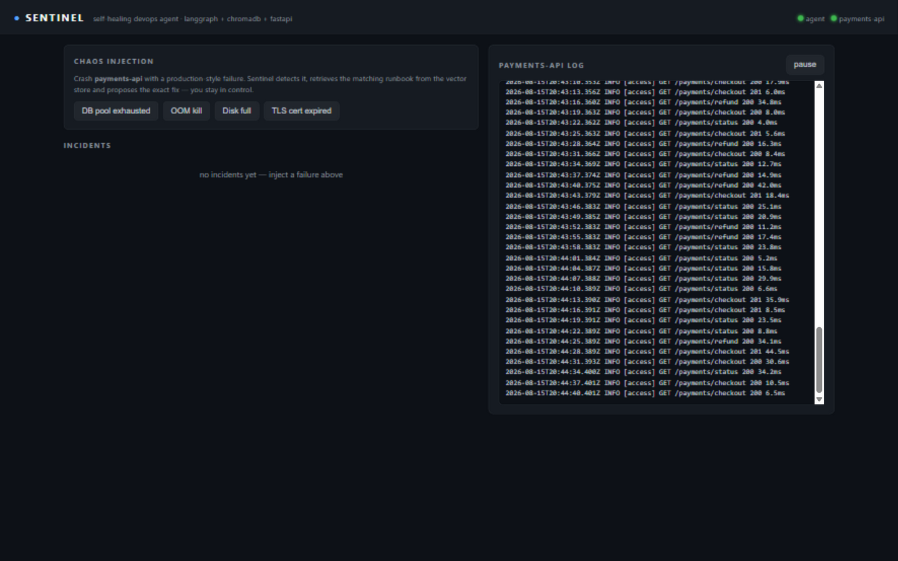
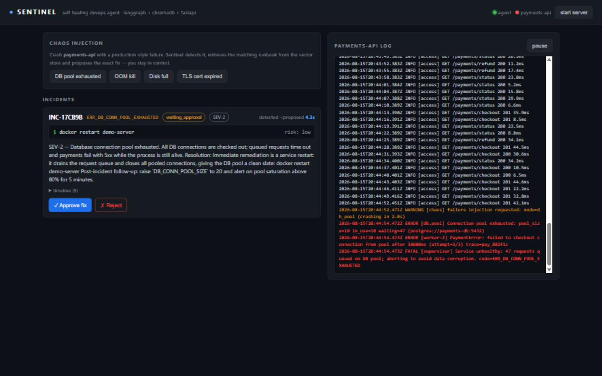
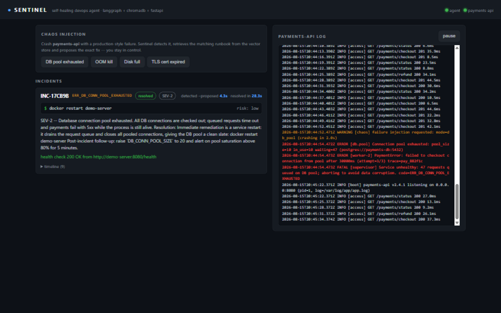
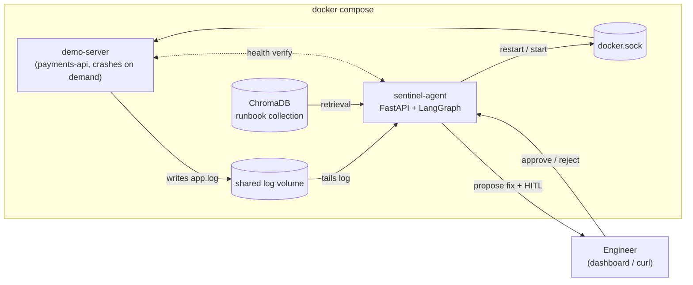
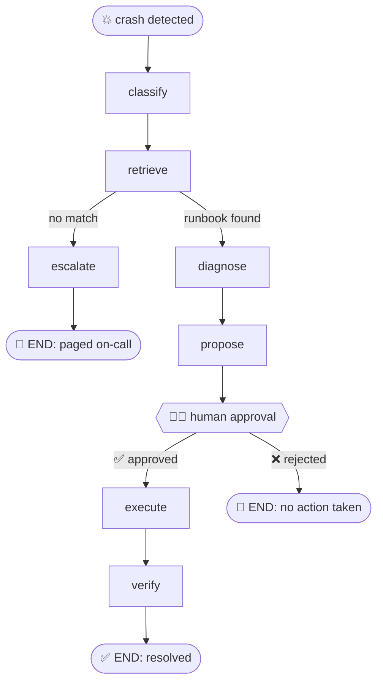

<p align="center">
  
</p>

<h1 align="center">Sentinel — Self-Healing DevOps Agent</h1>

<p align="center">
  <b>A server crashes. In seconds, an agent reads the log, matches the error against a vector store of runbooks, and proposes the exact fix command. A human approves. The agent executes the fix and verifies recovery.</b>
</p>

<p align="center">
  
  
  
  
  
  
</p>

---

## Repository Index

| Project | Description |
|---|---|
| **[Sentinel](.)** *(this project)* | Self-healing DevOps agent — LangGraph + ChromaDB + FastAPI |
| **[Graph-ML](./Graph-ML/)** | GNN fraud ring detection — PyTorch Geometric + NetworkX + FastAPI |

---

## The self-healing loop in action

| Step | What happens | Timing |
|---|---|---|
| 1. **Crash** | Demo `payments-api` crashes with a production-style error signature | — |
| 2. **Detect** | Monitor tails the log, groups error lines, extracts `ERR_*` code | ~1–2 s |
| 3. **Retrieve** | LangGraph queries ChromaDB — exact code match first, semantic fallback | < 1 s |
| 4. **Diagnose** | Root-cause analysis (runbook template, or LLM-enriched if API key set) | < 0.5 s |
| 5. **Propose** | Graph pauses at `interrupt()` — asks engineer: *"Apply `docker restart demo-server`?"* | **< 5 s total** |
| 6. **Approve** | Human clicks **Approve** on the dashboard (or via API) | — |
| 7. **Execute** | Agent runs whitelisted remediation through the Docker API | ~2 s |
| 8. **Verify** | Health endpoint polled — incident closed only on `200 OK` | ~2 s |

<p align="center">
  <b>Crash → detection → fix proposed in &lt; 5 seconds. Full close in &lt; 30 seconds.</b>
</p>

## Dashboard walkthrough

<table>
  <tr>
    <td width="33%"><b>Idle</b><br></td>
    <td width="33%"><b>Incident detected + fix proposed</b><br></td>
    <td width="33%"><b>Resolved — server healed</b><br></td>
  </tr>
</table>

## Architecture



## The healing state machine



`human_gate` blocks on `langgraph.types.interrupt()` backed by an in-memory checkpointer; the FastAPI approve/reject endpoints resume the same thread with `Command(resume=...)`.

## Quickstart

```bash
git clone https://github.com/HariHaran9597/Sentinel-Self-Healing-DevOps-Agent.git
cd Sentinel-Self-Healing-DevOps-Agent
docker compose up --build
```

| Endpoint | URL |
|---|---|
| **Dashboard** | http://localhost:8000 |
| **Agent API** (FastAPI docs) | http://localhost:8000/docs |
| **Demo server** (the crashable victim) | http://localhost:8080/health |

### 90-second scripted demo

```bash
# terminal 1
docker compose up --build

# terminal 2 — full loop: crash → detect → propose → approve → execute → verify
python scripts/demo.py --mode db_pool --yes

# the engineer says NO (human-in-the-loop proof)
python scripts/demo.py --mode ssl --reject
```

## API

| Method | Path | Purpose |
|---|---|---|
| `GET` | `/api/incidents` | Incident list (newest first) |
| `GET` | `/api/incidents/{id}` | Incident + full timeline |
| `POST` | `/api/incidents/{id}/approve` | **HITL** — execute the proposed fix |
| `POST` | `/api/incidents/{id}/reject` | **HITL** — refuse the fix |
| `POST` | `/api/chaos` | Inject a failure (`db_pool` / `oom` / `disk` / `ssl`) |
| `POST` | `/api/server/start` | Bring the demo server back up |
| `GET` | `/api/status` | Agent + demo server liveness |
| `GET` | `/api/logs/tail` | Tail the watched service log |

## Design decisions

| Decision | Why |
|---|---|
| **Whitelisted actions only** | The executor maps runbook `fix_action` to Docker API calls. An LLM can enrich the *diagnosis*, never the *execution*. No arbitrary shell. |
| **No API key required** | ChromaDB with the default local embedding model (downloaded at image build so the first incident is never slow). Optional LLM degrades gracefully. |
| **Crash-grouping + cooldown** | A crash writes several error lines in one flush → one incident. Per-code cooldown prevents restart loops from spamming. |
| **Container stays down on purpose** | `demo-server` has `restart: "no"` — when it crashes it *stays* down, so the agent's heal is visible (vs. Docker silently restarting). |
| **Verified healing** | An incident is only `resolved` after the health endpoint returns 200 post-remediation. |

## Project structure

```
├── docker-compose.yml              demo-server + agent, shared log, docker.sock
├── agent/
│   ├── Dockerfile
│   ├── runbooks/                   markdown runbooks (YAML frontmatter: error codes, fix)
│   ├── tests/                      unit tests: monitor, store, graph HITL paths
│   └── app/
│       ├── main.py                 FastAPI: HITL endpoints, chaos proxy, dashboard
│       ├── monitor.py              Phase 1: log tailing, error grouping, cooldown
│       ├── graph.py                Phase 2: LangGraph state machine
│       ├── nodes.py                classify / retrieve / diagnose / propose / gate / execute / verify
│       ├── runbooks.py             ChromaDB seeding + retrieval (exact match, semantic fallback)
│       ├── executor.py             whitelisted remediation via Docker API (or local subprocess)
│       ├── llm.py                  optional LLM diagnosis with graceful fallback
│       └── static/dashboard.html   dark-mode ops dashboard (vanilla JS)
├── demo-server/
│   └── server.py                   payments-api: realistic logs + 4 scripted crash modes
├── scripts/
│   └── demo.py                     end-to-end demo driver (stdlib only)
└── docs/images/                    dashboard screenshots
```

## Local development (no Docker)

```bash
python -m venv .venv && source .venv/bin/activate  # Windows: .venv/Scripts/activate
pip install -r agent/requirements-dev.txt

# terminal 1 — demo server
LOG_PATH=./logs/app.log python demo-server/server.py

# terminal 2 — agent (EXECUTOR_MODE=local relaunches the server as a subprocess)
LOG_PATH=./logs/app.log EXECUTOR_MODE=local \
  python -m uvicorn app.main:app --app-dir agent --port 8000

python scripts/demo.py --mode db_pool --yes
```

## Testing

```bash
pytest agent/tests -q
```

Covers runbook parsing, monitor grouping/cooldown, incident store, and the full LangGraph flow in dry-run mode — including pause-at-interrupt → resume-approve → resolved, the reject path, and escalation on unknown errors.


## License

[MIT](LICENSE)
