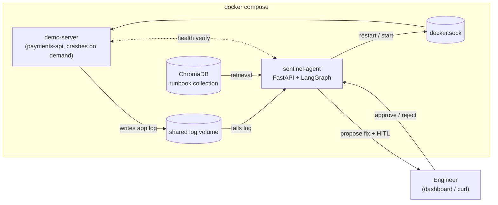
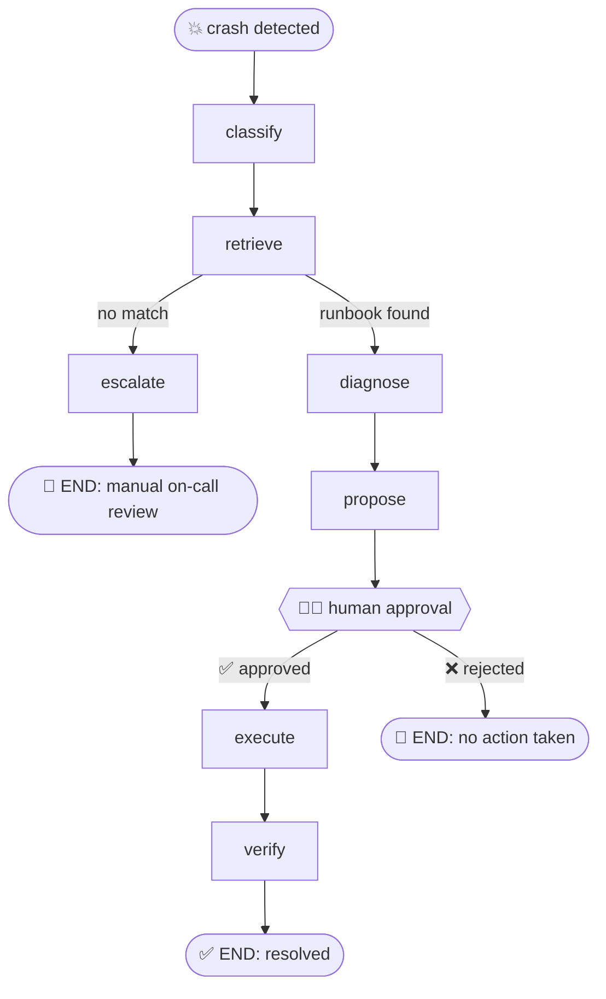

<p align="center">
  
</p>

<h1 align="center">Sentinel — Self-Healing DevOps Agent</h1>

<p align="center">
  <b>A server crashes. In seconds, an agent reads the log, matches the error against a vector store of runbooks, and proposes the exact fix command. A human approves. The agent executes the fix and verifies recovery.</b>
</p>

<p align="center">
  
  
  
  
  
  
  
</p>

<p align="center">
  <a href="https://hariharan9597.github.io/Sentinel-Self-Healing-DevOps-Agent/">Live Interactive Demo</a>
  &nbsp;|&nbsp;
  <a href="https://hariharan9597.github.io/Sentinel-Self-Healing-DevOps-Agent/sentinel-60s.mp4">60-second benchmark walkthrough</a>
  &nbsp;|&nbsp;
  <a href="#architecture">Architecture</a>
  &nbsp;|&nbsp;
  <a href="#evaluation-status">Evaluation status</a>
</p>

> The public demo is a safe browser-based simulation of the incident loop. Run the Docker
> quickstart below to exercise the real agent, Docker remediation, and human approval flow.

---

---

## The self-healing loop in action

| Step | What happens | Evidence |
|---|---|---|
| 1. **Inject** | Demo `payments-api` receives a controlled fault | Local Docker demo |
| 2. **Detect** | Monitor tails the log, groups error lines, extracts `ERR_*` code | Local Docker demo |
| 3. **Retrieve** | LangGraph queries ChromaDB — exact code match first, semantic fallback | Local Docker demo |
| 4. **Diagnose** | Runbook diagnosis with optional evidence-grounded LLM assessment | Local Docker demo |
| 5. **Propose** | Graph pauses at `interrupt()` and requests engineer approval | Local Docker demo |
| 6. **Approve** | Human clicks **Approve** on the dashboard (or via API) | — |
| 7. **Execute** | Agent runs allowlisted remediation through the Docker API | Local Docker demo |
| 8. **Verify** | Agent checks service health after the action | Local Docker demo |

The hosted page includes the completed, recorded local evaluation below. Its interactive controls are a browser simulation; run Docker Compose to use the real agent and approval flow.

## Matched strategy evaluation

The evaluator compares four strategies on matched fault seeds: a fixed restart, a static error-code-to-action dictionary, ChromaDB runbook retrieval with the allowlisted executor (without LangGraph), and the complete Sentinel workflow. The scoped benchmark uses three faults: a bad release requiring rollback, a paraphrased configuration failure without an error code, and an impacting unknown fault requiring escalation. Other fault modes remain available in the local demo but are outside the published comparison. Control arms pause Sentinel's monitor so they cannot receive hidden help from the workflow. Sentinel escalation counts are reported separately from baseline abstentions.

The evaluator compares all four strategies across these three controlled faults, using five matched seeds, an independent `/payments/status` probe, and a 30-second continuous-health soak: 60 trial records total. These are deterministic lab repetitions, not independent production incidents. The semantic retrieval strategy shares the runbooks and allowlisted executor with Sentinel; this isolates retrieval and workflow contributions without claiming that the full graph outperforms a correct static map on exact-code cases.

### Recorded result (2026-11-01)

| Strategy | Sustained recovery on known faults (10 trials) | Safe handling of impacting unknown (5 trials) | Recovery median | p95 / max |
|---|---:|---:|---:|---:|
| Fixed restart | 0/10 (0%; 95% Wilson CI 0–27.8%) | 0/5 (0%; 0–43.5%); acted unnecessarily in all five | — | — |
| Static dictionary | 5/10 (50%; 23.7–76.3%) | 5/5 abstained safely (100%; 56.6–100%) | 2.03 s (n=5) | 5.30 / 5.30 s |
| Semantic retrieval | 10/10 (100%; 72.3–100%) | 5/5 abstained safely (100%; 56.6–100%) | 3.07 s (n=10) | 8.91 / 8.91 s |
| Sentinel runbook | 10/10 (100%; 72.3–100%) | 5/5 escalated safely (100%; 56.6–100%) | 2.54 s (n=10) | 6.25 / 6.25 s |

Each strategy ran five matched seeds for each of three controlled faults (60 arms total). Recovery rates use only the 10 faults expected to recover; safe-handling rates use the five impacting-unknown trials. Latency is measured from fault-injection request start to first independent HTTP 200, among sustained recoveries only; p95 uses nearest-rank and equals the max at these sample sizes. All strategies made zero false recovery claims. The exact per-trial report, run date, intervals, and limitations are in [`docs/results/sentinel-comparison.json`](docs/results/sentinel-comparison.json).

This result supports a narrow conclusion: semantic retrieval handled the paraphrased fixture that the exact-code dictionary missed, while Sentinel and semantic retrieval tied on the measured outcomes. It does not show that LangGraph or an LLM improves reliability over semantic retrieval. The confidence intervals are wide because there are only five deterministic repetitions per fault; these are controlled local fixtures, not independent production incidents. The evaluator auto-approves Sentinel actions, so it does not measure the human approval workflow. Optional Groq diagnosis is excluded.

The [60-second benchmark walkthrough](docs/sentinel-60s.mp4) is a generated visual summary of this JSON report, not a live screen recording.

Reproduce the comparison after Docker Compose is ready. It takes substantial time because every arm uses an injection-relative 60-second maximum observation window and a 30-second independent health soak:

```powershell
docker compose up --build -d
python scripts/evaluate_sentinel.py --replicates 5 --soak-seconds 30 --observation-seconds 60
```

## Evaluation methodology and limits

The previous report was withdrawn because the independent probe started only after remediation returned. This replacement starts host-side probing immediately after injection, concurrently with diagnosis and action. All strategies share the same 60-second injection-relative window and the same 30-second continuous-health requirement. The JSON records each trial, probe count, outcome, and timing.

The evaluator auto-approves proposed Sentinel actions; the separate interactive demo retains its human approval gate. These deterministic local fault fixtures do not establish customer or production reliability. The five repeats per fault are not independent field incidents, and the confidence intervals are correspondingly broad. This benchmark does not test the optional LLM diagnosis.

## Dashboard walkthrough

<table>
  <tr>
    <td width="33%"><b>Idle</b><br></td>
    <td width="33%"><b>Incident detected + fix proposed</b><br></td>
    <td width="33%"><b>Resolved — server healed</b><br></td>
  </tr>
</table>

## Architecture



## The healing state machine



`human_gate` blocks on `langgraph.types.interrupt()` backed by a SQLite checkpointer; the FastAPI approve/reject endpoints resume the same thread with `Command(resume=...)`, including after the agent container restarts.

## Quickstart

```bash
git clone https://github.com/HariHaran9597/Sentinel-Self-Healing-DevOps-Agent.git
cd Sentinel-Self-Healing-DevOps-Agent
docker compose up --build
```

| Endpoint | URL |
|---|---|
| **Dashboard** | http://localhost:18000 |
| **Agent API** (FastAPI docs) | http://localhost:18000/docs |
| **Demo server** (the crashable victim) | http://localhost:18080/health |

The host ports bind to `127.0.0.1` and default to `18000`/`18080` to avoid common local port conflicts. Override them with `SENTINEL_AGENT_PORT` and `SENTINEL_DEMO_PORT` if needed. Optional Groq diagnosis is disabled by default. To enable it, copy `.env.example` to `.env`, set `LLM_DIAGNOSIS_ENABLED=true` and add a rotated `GROQ_API_KEY`. The key stays server-side. Groq receives redacted log excerpts and runbook candidates; only use sanitized demo logs. Its response is constrained to candidate runbook actions or escalation, and remediation still requires the human gate.

Incident timelines and pending LangGraph approvals are stored in the `sentinel_data` Docker volume and survive an agent restart. The Docker executor refuses to act on containers without the `com.hariharan.sentinel.managed=true` label. The Docker socket still grants the agent container broad access to the local Docker daemon, so run this lab only on a machine you control and never point it at production workloads.

### 90-second scripted demo

```bash
# terminal 1
docker compose up --build

# terminal 2 — full loop: crash → detect → propose → approve → execute → verify
python scripts/demo.py --base http://127.0.0.1:18000 --mode db_pool --yes

# the engineer says NO (human-in-the-loop proof)
python scripts/demo.py --base http://127.0.0.1:18000 --mode ssl --reject
```

## API

| Method | Path | Purpose |
|---|---|---|
| `GET` | `/api/incidents` | Incident list (newest first) |
| `GET` | `/api/incidents/{id}` | Incident + full timeline |
| `POST` | `/api/incidents/{id}/approve` | **HITL** — execute the proposed fix |
| `POST` | `/api/incidents/{id}/reject` | **HITL** — refuse the fix |
| `POST` | `/api/chaos` | Inject a failure (`db_pool`, `oom`, `ssl`, `bad_config`, `paraphrased_config`, `dependency_down`, `bad_release`, `unknown`, `impacting_unknown`, `ambiguous`) |
| `POST` | `/api/server/start` | Bring the demo server back up |
| `GET` | `/api/status` | Agent + demo server liveness |
| `GET` | `/api/logs/tail` | Tail the watched service log |

## Design decisions

| Decision | Why |
|---|---|
| **Whitelisted actions only** | The executor maps runbook `fix_action` to Docker API calls. An LLM can enrich the *diagnosis*, never the *execution*. No arbitrary shell. |
| **No API key required** | ChromaDB with the default local embedding model (downloaded at image build so the first incident is never slow). Optional LLM degrades gracefully. |
| **Crash-grouping + cooldown** | A crash writes several error lines in one flush → one incident. Per-code cooldown prevents restart loops from spamming. |
| **Container stays down on purpose** | `demo-server` has `restart: "no"` — when it crashes it *stays* down, so the agent's heal is visible (vs. Docker silently restarting). |
| **Verified healing** | An incident is only `resolved` after the health endpoint returns 200 post-remediation. |

## Project structure

```
├── docker-compose.yml              demo-server + agent, shared log, docker.sock
├── agent/
│   ├── Dockerfile
│   ├── runbooks/                   markdown runbooks (YAML frontmatter: error codes, fix)
│   ├── tests/                      unit tests: monitor, store, graph HITL paths
│   └── app/
│       ├── main.py                 FastAPI: HITL endpoints, chaos proxy, dashboard
│       ├── monitor.py              Phase 1: log tailing, error grouping, cooldown
│       ├── graph.py                Phase 2: LangGraph state machine
│       ├── nodes.py                classify / retrieve / diagnose / propose / gate / execute / verify
│       ├── runbooks.py             ChromaDB seeding + retrieval (exact match, semantic fallback)
│       ├── executor.py             whitelisted remediation via Docker API (or local subprocess)
│       ├── llm.py                  optional LLM diagnosis with graceful fallback
│       └── static/dashboard.html   dark-mode ops dashboard (vanilla JS)
├── demo-server/
│   └── server.py                   payments-api: realistic logs + 3 crash and 7 persistent-failure modes
├── scripts/
│   └── demo.py                     end-to-end demo driver (stdlib only)
└── docs/images/                    dashboard screenshots
```

## Local development (no Docker)

```bash
python -m venv .venv && source .venv/bin/activate  # Windows: .venv/Scripts/activate
pip install -r agent/requirements-dev.txt

# terminal 1 — demo server
LOG_PATH=./logs/app.log python demo-server/server.py

# terminal 2 — agent (EXECUTOR_MODE=local relaunches the server as a subprocess)
LOG_PATH=./logs/app.log EXECUTOR_MODE=local \
  python -m uvicorn app.main:app --app-dir agent --port 8000

python scripts/demo.py --mode db_pool --yes
```

## Testing

```bash
pytest agent/tests -q
```

Covers runbook parsing, monitor grouping/cooldown, durable incident storage, managed-container guard, LLM opt-in, and the LangGraph approval, rejection, safe escalation, and recovery paths.


## License

[MIT](LICENSE)
