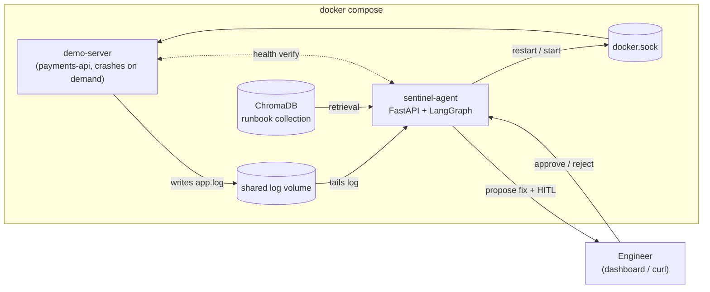

<p align="center">
  
</p>

<h1 align="center">Sentinel — Self-Healing DevOps Agent</h1>

<p align="center">
  <b>A server crashes. In seconds, an agent reads the log, matches the error against a vector store of runbooks, and proposes the exact fix command. A human approves. The agent executes the fix and verifies recovery.</b>
</p>

<p align="center">
  
  
  
  
  
  
  
</p>

<p align="center">
  <a href="https://hariharan9597.github.io/Sentinel-Self-Healing-DevOps-Agent/">Live Interactive Demo</a>
  &nbsp;|&nbsp;
  <a href="#architecture">Architecture</a>
  &nbsp;|&nbsp;
  <a href="#the-self-healing-loop-in-action">Evidence</a>
  &nbsp;|&nbsp;
  <a href="docs/sentinel-60s.mp4">60-second walkthrough</a>
</p>

> The public demo is a safe browser-based simulation of the incident loop. Run the Docker
> quickstart below to exercise the real agent, Docker remediation, and human approval flow.

---

## Repository Index

| Project | Description |
|---|---|
| **[Sentinel](.)** *(this project)* | Self-healing DevOps agent — LangGraph + ChromaDB + FastAPI |
| **[Graph-ML](./Graph-ML/)** | GNN fraud ring detection — PyTorch Geometric + NetworkX + FastAPI |

---

## The self-healing loop in action

| Step | What happens | Timing |
|---|---|---|
| 1. **Crash** | Demo `payments-api` crashes with a production-style error signature | Controlled injection |
| 2. **Detect** | Monitor tails the log, groups error lines, extracts `ERR_*` code | Measured in recorded run |
| 3. **Retrieve** | LangGraph queries ChromaDB — exact code match first, semantic fallback | Measured in recorded run |
| 4. **Diagnose** | Root-cause analysis (runbook template, or opt-in LLM-enriched diagnosis) | Measured in recorded run |
| 5. **Propose** | Graph pauses at `interrupt()` — asks engineer: *"Apply `docker restart demo-server`?"* | Measured in recorded run |
| 6. **Approve** | Human clicks **Approve** on the dashboard (or via API) | — |
| 7. **Execute** | Agent runs whitelisted remediation through the Docker API | Measured in recorded run |
| 8. **Verify** | Health endpoint polled — incident closed only on `200 OK` | Measured in recorded run |

Timing varies by machine; these measurements are not an SLA.

## Matched-seed recovery evaluation

Sentinel is compared with a deliberately simple **restart-only remediation baseline** on the same five seeds across three persistent faults and one unknown signal. Bad config and bad release survive a process restart; dependency outage is a separate labeled container; the unknown signal should not trigger an action. The monitor remains active during the baseline arm, but the evaluator approves no remediation; this isolates the effect of the restart-only intervention, not monitor compute overhead. For Sentinel, the evaluator auto-approves proposed actions, then independently probes `/payments/status` from the host and requires 30 seconds of continuous health. It records injection-to-recovery median, p95 and max, recovery rates, unnecessary actions, correct escalation, and Wilson 95% intervals.

Run the complete comparison after starting Docker Compose (about 20–25 minutes at default settings):

```powershell
docker compose up --build -d
python scripts/evaluate_sentinel.py --replicates 5 --soak-seconds 30
```

The current recorded JSON is [here](docs/results/sentinel-comparison.json), with per-trial evidence, methodology, uncertainty intervals, and limitations. This is a small controlled lab comparison, not evidence of production reliability or a customer SLO. The evaluation driver auto-approves proposed actions; it does not measure a human approval workflow.

## Resume evidence

> Built Sentinel, a Docker Compose incident-remediation agent with LangGraph runbook retrieval, human approval, allowlisted Docker actions, and an independent sustained-health probe. In 40 matched-seed local trials (5 per scenario), Sentinel recovered 15/15 actionable persistent faults and correctly escalated 5/5 unknown signals, while a restart-only baseline recovered 0/15 and restarted unnecessarily on 5/5 unknown signals. Sentinel recovery latency was 4.50 s median and 9.19 s p95, measured from injection to first external business-probe success and accepted only after 30 seconds of continuous health.

This is a controlled local fixture comparison, not production reliability evidence. Wilson 95% intervals are broad (15/15 recovery: 79.6–100%; 5/5 escalation: 56.6–100%), and the evaluation driver auto-approved actions. The baseline monitor can create an unapproved incident record; it does not execute a fix. See the dated [trial record](docs/results/sentinel-comparison.json) and its full limitations. Do not cite the retired “20/20 expected outcomes” result.

The public site also includes a 60-second visual walkthrough generated from this report. Regenerate it after a new run with `pip install -r scripts/requirements-video.txt` followed by `python scripts/make_demo_video.py`.

## Dashboard walkthrough

<table>
  <tr>
    <td width="33%"><b>Idle</b><br></td>
    <td width="33%"><b>Incident detected + fix proposed</b><br></td>
    <td width="33%"><b>Resolved — server healed</b><br></td>
  </tr>
</table>

## Architecture



## The healing state machine


`human_gate` blocks on `langgraph.types.interrupt()` backed by a SQLite checkpointer; the FastAPI approve/reject endpoints resume the same thread with `Command(resume=...)`, including after the agent container restarts.

## Quickstart

```bash
git clone https://github.com/HariHaran9597/Sentinel-Self-Healing-DevOps-Agent.git
cd Sentinel-Self-Healing-DevOps-Agent
docker compose up --build
```

| Endpoint | URL |
|---|---|
| **Dashboard** | http://localhost:18000 |
| **Agent API** (FastAPI docs) | http://localhost:18000/docs |
| **Demo server** (the crashable victim) | http://localhost:18080/health |

The host ports bind to `127.0.0.1` and default to `18000`/`18080` to avoid common local port conflicts. Override them with `SENTINEL_AGENT_PORT` and `SENTINEL_DEMO_PORT` if needed. Optional Groq diagnosis is disabled by default. To enable it, copy `.env.example` to `.env`, set `LLM_DIAGNOSIS_ENABLED=true` and add a rotated `GROQ_API_KEY`. The key stays server-side. Groq receives redacted log excerpts and runbook candidates; only use sanitized demo logs. Its response is constrained to candidate runbook actions or escalation, and remediation still requires the human gate.

Incident timelines and pending LangGraph approvals are stored in the `sentinel_data` Docker volume and survive an agent restart. The Docker executor refuses to act on containers without the `com.hariharan.sentinel.managed=true` label. The Docker socket still grants the agent container broad access to the local Docker daemon, so run this lab only on a machine you control and never point it at production workloads.

### 90-second scripted demo

```bash
# terminal 1
docker compose up --build

# terminal 2 — full loop: crash → detect → propose → approve → execute → verify
python scripts/demo.py --base http://127.0.0.1:18000 --mode db_pool --yes

# the engineer says NO (human-in-the-loop proof)
python scripts/demo.py --base http://127.0.0.1:18000 --mode ssl --reject
```

## API

| Method | Path | Purpose |
|---|---|---|
| `GET` | `/api/incidents` | Incident list (newest first) |
| `GET` | `/api/incidents/{id}` | Incident + full timeline |
| `POST` | `/api/incidents/{id}/approve` | **HITL** — execute the proposed fix |
| `POST` | `/api/incidents/{id}/reject` | **HITL** — refuse the fix |
| `POST` | `/api/chaos` | Inject a failure (`db_pool`, `oom`, `ssl`, `bad_config`, `dependency_down`, `bad_release`, `unknown`) |
| `POST` | `/api/server/start` | Bring the demo server back up |
| `GET` | `/api/status` | Agent + demo server liveness |
| `GET` | `/api/logs/tail` | Tail the watched service log |

## Design decisions

| Decision | Why |
|---|---|
| **Whitelisted actions only** | The executor maps runbook `fix_action` to Docker API calls. An LLM can enrich the *diagnosis*, never the *execution*. No arbitrary shell. |
| **No API key required** | ChromaDB with the default local embedding model (downloaded at image build so the first incident is never slow). Optional LLM degrades gracefully. |
| **Crash-grouping + cooldown** | A crash writes several error lines in one flush → one incident. Per-code cooldown prevents restart loops from spamming. |
| **Container stays down on purpose** | `demo-server` has `restart: "no"` — when it crashes it *stays* down, so the agent's heal is visible (vs. Docker silently restarting). |
| **Verified healing** | An incident is only `resolved` after the health endpoint returns 200 post-remediation. |

## Project structure

```
├── docker-compose.yml              demo-server + agent, shared log, docker.sock
├── agent/
│   ├── Dockerfile
│   ├── runbooks/                   markdown runbooks (YAML frontmatter: error codes, fix)
│   ├── tests/                      unit tests: monitor, store, graph HITL paths
│   └── app/
│       ├── main.py                 FastAPI: HITL endpoints, chaos proxy, dashboard
│       ├── monitor.py              Phase 1: log tailing, error grouping, cooldown
│       ├── graph.py                Phase 2: LangGraph state machine
│       ├── nodes.py                classify / retrieve / diagnose / propose / gate / execute / verify
│       ├── runbooks.py             ChromaDB seeding + retrieval (exact match, semantic fallback)
│       ├── executor.py             whitelisted remediation via Docker API (or local subprocess)
│       ├── llm.py                  optional LLM diagnosis with graceful fallback
│       └── static/dashboard.html   dark-mode ops dashboard (vanilla JS)
├── demo-server/
│   └── server.py                   payments-api: realistic logs + 4 scripted crash modes
├── scripts/
│   └── demo.py                     end-to-end demo driver (stdlib only)
└── docs/images/                    dashboard screenshots
```

## Local development (no Docker)

```bash
python -m venv .venv && source .venv/bin/activate  # Windows: .venv/Scripts/activate
pip install -r agent/requirements-dev.txt

# terminal 1 — demo server
LOG_PATH=./logs/app.log python demo-server/server.py

# terminal 2 — agent (EXECUTOR_MODE=local relaunches the server as a subprocess)
LOG_PATH=./logs/app.log EXECUTOR_MODE=local \
  python -m uvicorn app.main:app --app-dir agent --port 8000

python scripts/demo.py --mode db_pool --yes
```

## Testing

```bash
pytest agent/tests -q
```

Covers runbook parsing, monitor grouping/cooldown, durable incident storage, managed-container guard, LLM opt-in, and the LangGraph approval, rejection, safe escalation, and recovery paths.


## License

[MIT](LICENSE)
